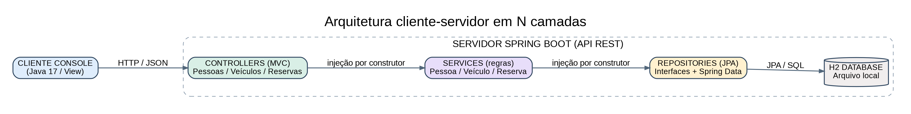
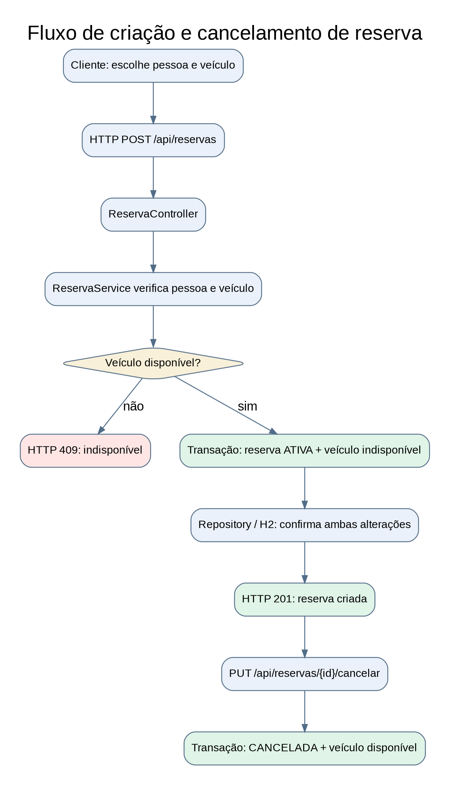

# Garagem de Veículos — N3: Cliente-Servidor e Arquitetura em N Camadas

Trabalho individual da disciplina **Arquitetura de Software (ESW430)** — Engenharia de Software, UniRV, 2026.  
**Aluno:** Wayser Henrique de Faria Lopes  
**Tema 5:** Estilo cliente-servidor e arquiteturas em N camadas.  
**Professor:** Elielton de Souza Silva Monteiro.

## 1. Objetivo e entregável

Demonstrar a **separação física entre cliente e servidor em dois projetos distintos**, conectados por HTTP/JSON, preservando no servidor as camadas **Controller (MVC), Service, Repository e Model** e a injeção de dependências. O sistema permite listar/cadastrar pessoas e veículos, criar reservas de veículos disponíveis e cancelar reservas.

> Este repositório é um exemplo acadêmico executável. O serviço possui dados iniciais de demonstração e grava alterações em banco H2 local. Não possui autenticação: não deve ser exposto na Internet como serviço de produção.

## 2. Tecnologias

- Java **17+**
- **Servidor**: Spring Boot 3.5.16, Spring Web MVC, Spring Data JPA, Bean Validation e H2.
- **Cliente separado**: Java 17 puro (projeto Maven independente, sem bibliotecas adicionais), `java.net.http.HttpClient` (sem dependências externas).
- **Comunicação**: API REST em HTTP com mensagens JSON.
- **Banco**: H2 gravado em `servidor-api/garagem.mv.db`.
- **Testes**: JUnit 5 + MockMvc.

## 3. Pré-requisitos

1. Instale **JDK 17 ou superior** e confirme com `java -version`.
2. Instale **Apache Maven 3.6.3 ou superior** e confirme com `mvn -version`.
3. Na primeira execução, mantenha conexão com a internet para o Maven baixar dependências.
4. Deixe a porta **8080** livre.

## 4. Execução completa — a partir da raiz do repositório

### Terminal 1 — iniciar o servidor

```bash
cd servidor-api
mvn spring-boot:run
```

**Mantenha este terminal aberto.** Aguarde a mensagem `Started GaragemApplication`.

Para verificar, abra no navegador: **http://localhost:8080/api/status**. Resultado esperado: um JSON com `"status":"online"`.

### Terminal 2 — iniciar o cliente (outro terminal)

Volte para a **pasta raiz do repositório**, onde ficam as pastas `servidor-api` e `cliente-console`. Então execute:

```bash
java cliente-console/src/main/java/GaragemCliente.java
```

Alternativamente, entre em `cliente-console` e execute `mvn -q compile exec:java`. O menu apresenta opções de 1 a 7. Uma sequência para testar: **1** listar pessoas; **3** listar veículos; **6** reservar informando os IDs exibidos; **5** listar reservas; **7** cancelar informando ID; **3** verificar se o veículo voltou a ficar disponível. Para sair, pressione **0**.

**No Windows:** execute os mesmos comandos no PowerShell (Java e Maven devem estar no PATH). Se o terminal estiver na pasta `servidor-api`, use `cd ..` antes do comando do cliente.

### Testes automatizados

Em um terceiro terminal, dentro de `servidor-api` (ou após parar o servidor), execute:

```bash
mvn test
```

O teste de integração exercita os endpoints de cadastro, reserva, bloqueio de duplicidade, cancelamento e validação de entrada. Durante os testes, é usado H2 em memória, isolado da base de demonstração.

## 5. Estrutura dos DOIS projetos

```text
Garagem_Veiculos_N3_Cliente_Servidor/
├── cliente-console/                # projeto 1: apresentação e HTTP (Java puro)
│   ├── src/main/java/GaragemCliente.java
│   ├── pom.xml
│   └── README.md
├── servidor-api/                   # projeto 2: API (Spring Boot)
│   ├── pom.xml
│   └── src/
│       ├── main/java/br/edu/unirv/garagem/
│       │   ├── controller/         # Controller (MVC)
│       │   ├── dto/                # validação de entrada
│       │   ├── service/            # regras de negócio
│       │   ├── repository/         # interfaces JpaRepository
│       │   ├── model/              # entidades (Model)
│       │   └── exception/          # erros HTTP
│       └── test/                   # integração HTTP com MockMvc
├── docs/                           # diagramas .svg, .png e fontes .dot
├── .gitignore
└── README.md
```

O cliente **não importa** classes do servidor e **não acessa** diretamente o banco. A API é o contrato que permite inclusive substituí-lo por outro cliente.

## 6. Diagramas

**Componentes e camadas:**



**Fluxo de uma reserva e cancelamento:**



Fontes dos diagramas estão em `docs/*.dot`; os SVGs podem ser abertos separadamente em alta resolução.

## 7. API REST — contrato

| Método | Rota | Resultado |
|---|---|---|
| GET | `/api/status` | confirma API online |
| GET | `/api/pessoas` | lista pessoas |
| GET | `/api/pessoas/{id}` | detalha uma pessoa |
| POST | `/api/pessoas` | cadastra pessoa |
| GET | `/api/veiculos` | lista veículos |
| GET | `/api/veiculos/{id}` | detalha um veículo |
| POST | `/api/veiculos` | cadastra veículo |
| GET | `/api/reservas` | lista reservas |
| GET | `/api/reservas/{id}` | detalha uma reserva |
| POST | `/api/reservas` | cria reserva se veículo disponível |
| PUT | `/api/reservas/{id}/cancelar` | cancela e libera veículo |

Exemplos dos corpos JSON:

```json
{"nome":"Ana Silva","email":"ana@example.com"}
```

Para `POST /api/pessoas`.

```json
{"placa":"ABC1D23","modelo":"Honda Civic"}
```

Para `POST /api/veiculos`.

```json
{"pessoaId":1,"veiculoId":1}
```

Para `POST /api/reservas`. Primeiro consulte os IDs, pois eles dependem da base. Os status HTTP incluem **201** (criado), **400** (validação), **404** (não encontrado) e **409** (conflito/veículo ocupado).

## 8. Arquitetura, Repository, DI, MVC e SOLID

- **Cliente-servidor**: console em processo/projeto independente envia requisições HTTP para API Spring Boot. Servidor concentra dados e regras.
- **N camadas**: apresentação (console + controllers REST), aplicação (services), persistência (repositories), domínio (models), banco H2.
- **MVC**: Controller é implementado pelos `@RestController`; Model representa entidades e regras da aplicação; View é o cliente console que apresenta respostas ao usuário, utilizando a API como fronteira.
- **Repository**: interfaces `PessoaRepository`, `VeiculoRepository` e `ReservaRepository` estendem `JpaRepository`; controllers não manipulam banco.
- **DI e inversão de dependência**: construtores recebem interfaces de repositório e serviços; Spring fornece as implementações automaticamente.
- **SOLID**: responsabilidade única nas camadas; dependência de contratos (`JpaRepository`) em vez de instanciar infraestrutura; serviços são independentes da apresentação.
- **Consistência**: `@Transactional` une as mudanças de reserva e disponibilidade; bloqueio pessimista impede duas reservas simultâneas do mesmo veículo.

## 9. Dados e comportamento de negócio

Na primeira execução o servidor gera uma pessoa de demonstração e um veículo (`ABC1D23`, `Honda Civic`). Os dados seguintes permanecem gravados no arquivo H2 local, na pasta `servidor-api`. Para reiniciar a demonstração do zero, **com o servidor desligado**, exclua o arquivo `servidor-api/garagem.mv.db` e inicie novamente.

Regras implementadas: e-mail único, placa única e válida, pessoa/veículo existentes para reserva, reserva permitida apenas se disponível, liberação do veículo ao cancelar; conflitos de negócio devolvem `409`.

## 10. Integrante e uso de inteligência artificial

**Integrante:** Wayser Henrique de Faria Lopes (trabalho individual).

**Ferramenta de IA utilizada:** ChatGPT (OpenAI). Utilizada como apoio na estruturação da arquitetura, geração e revisão de exemplos de código, documentação, organização de testes e elaboração dos diagramas. Cabe ao aluno validar e compreender a solução.

## 11. Observações de entrega

- A pasta completa deve ser publicada em um **repositório público** no GitHub ou GitLab.
- O nome do repositório pode ser `garagem-veiculos-entrega1` (existente) ou outro a ser criado.
- No Classroom, enviar a URL pública e comentar: `Integrante: Wayser Henrique de Faria Lopes. Tema: Cliente-Servidor e Arquiteturas em N Camadas (Tema 5).`
- Este projeto NÃO publica o repositório automaticamente. Verifique os arquivos online e teste o comando do README na sua máquina antes de enviar.
